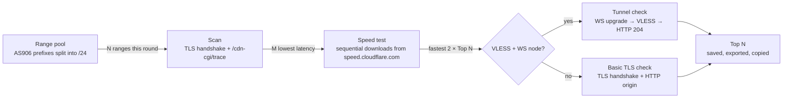

<div align="center">


# CF Best

**A desktop workbench for finding the best Cloudflare IPs**

Scan · Speed test · Availability check · Daily auto-optimize: a native, lightweight GUI that works without a subscription

[](https://github.com/wintopic/CF-BEST/actions/workflows/ci.yml)
[](https://github.com/wintopic/CF-BEST/releases/latest)
[](https://github.com/wintopic/CF-BEST/releases)
[](LICENSE)


[简体中文](README.md) · English


</div>

---

> The app's interface is in Simplified Chinese. This page explains what it does and how to use it.

## Why CF Best

Finding fast Cloudflare IPs usually means juggling several scripts: scan, speed-test, verify one by one, then tidy up the results by hand. CF Best turns that pipeline into one desktop app:

- **One click to results.** *Auto-optimize* scans a rotating batch of IP ranges, speed-tests the responsive addresses, verifies the fastest, and hands you today's Top N.
- **No subscription required.** Scanning, speed tests and auto-optimize need no proxy node. A full tunnel check runs only when you add a VLESS + WebSocket node.
- **Runs every day by itself.** It runs at a set time, catches up on a missed time, stays in the tray, and can start at login.
- **Native and light.** Rust and [GPUI](https://www.gpui.rs/), GPU-rendered. A single executable that starts fast, with no Electron.

## Features

| Page | What it does |
| --- | --- |
| **Auto-optimize** (start page) | Runs *scan → speed test → verify* once or daily, and keeps the Top N. The range pool advances each round, so every run covers new ranges |
| **Scan IP** | Finds reachable Cloudflare addresses in CIDRs, single IPs, ASN prefixes or suggested ranges, with colo and handshake latency |
| **Speed ranking** | Sequential download tests (quick screen and multi-round fine test), ranked by median speed, with a speed histogram and a latency/speed scatter plot |
| **Availability check** | Full tunnel check through VLESS + WebSocket subscription nodes (`vless://` links or a Clash profile), or a basic TLS check without nodes; passing IPs import into your proxy client in one click |
| **Range pool** (advanced) | Pick a pool strategy (balanced rotation, network-ranked, sequential), move the start point, probe how each range performs on your network, and classify each range's exit region |
| **History** (advanced) | Past runs, plus a Top 10 rank and speed comparison between the last two speed tests |

Also included:

- 🌏 **Lock the exit region.** Each range in the pool is classified by the Cloudflare colo it actually lands on from your network (Hong Kong, Japan, the US…). With a lock set, auto-optimize only scans ranges in those regions and only keeps IPs that exit there; colo codes such as `SJC` or `NRT` lock more precisely. Result tables show the colo, city and country, and scan results can be filtered by region before the speed test. Cloudflare addresses are anycast, so the same range lands on different colos from different networks: the classification is measured locally, not looked up in GeoIP. In the headless build it's in the web UI, and `cfbest-cli --region HK,JP` sets it for one run.
- 🔗 **One-click next step.** *Next: speed test* and *Next: verify* load the results and start the next step.
- 💾 **Results survive restarts.** The latest scan, speed test and verification results come back on launch.
- 📋 **Copy and export.** Click a row to copy `IP:port`, copy the whole Top N at once, and export TXT or CSV (opens in Excel).
- 📥 **Import into your proxy client.** After a tunnel check, the passing IPs are applied to your subscription node and imported into a local Clash Verge, Karing, Stash, FlClash or similar client in one click. You can also copy the local subscription URL or the node links. The client picks up each new auto-optimize round when it updates the subscription.
- 🔄 **Update check.** Checks at startup and once a day (can be turned off) and flags new versions at the bottom right of the status bar. One-click update races direct GitHub against mirrors popular in China such as gh-proxy.com, downloads over the fastest route, and verifies the file against the SHA-256 GitHub publishes. Windows swaps the exe and restarts; macOS opens the installer.
- ⏰ **Reliable scheduling.** A run starts once the time has passed and today has no run yet. A missed time is caught up, a busy app queues the run, and a scheduled run never switches your page.
- 🎨 **Themes.** Forest, Mint, Bee and Parchment, each light, dark or following the system, with UI scaling from 90% to 125%.
- ⌨️ **Keyboard-first.** Shortcuts for pages, start/stop and focus navigation.
- 🪟 **Windows integration.** Tray with notifications, taskbar progress, and start at login straight to the tray.

## Screenshots

| Scan IP | Speed ranking |
| :---: | :---: |
|  |  |
| **Availability check** | **Dark theme** |
|  |  |

## Download

Get the latest build from [**Releases**](https://github.com/wintopic/CF-BEST/releases/latest):

| Platform | File | Notes |
| --- | --- | --- |
| Windows 10 / 11 (x64) | `CFBest-<version>-windows-x64.exe` | Portable, just run it |
| macOS 11+ (Apple silicon / Intel) | `CFBest-<version>-macos-universal.dmg` | Drag **CF Best** into Applications |
| Linux server (x64 / ARM64) | `cfbest-cli-<version>-linux-x64` / `-linux-arm64` | Headless, managed in a browser, see [NAS and Linux](#nas-and-linux-web-ui) |
| NAS (Docker) | Image `ghcr.io/wintopic/cf-best`, or `cf-best-docker-<version>-linux-*.tar.gz` | Synology, ZSpace, fnOS and others, see [NAS and Linux](#nas-and-linux-web-ui) |

Every release ships a `SHA256SUMS.txt` for verifying downloads.

<details>
<summary><b>macOS says the developer cannot be verified?</b></summary>

The app is ad-hoc signed, not signed with an Apple Developer ID. On first launch, right-click **CF Best → Open** in Finder, or run:

```bash
xattr -dr com.apple.quarantine "/Applications/CF Best.app"
```

</details>

<details>
<summary><b>Windows shows "Windows protected your PC"?</b></summary>

The executable isn't code-signed, so SmartScreen warns about new files. Click **More info → Run anyway**. You can check the file against `SHA256SUMS.txt` first.

</details>

## NAS and Linux (web UI)

The headless build runs as a long-lived service on a NAS or Linux server and is managed from a browser: it runs the daily optimization on a schedule, and phones and computers on your LAN add its subscription URL to their proxy client, picking up the newest nodes after each run. The web UI can start or stop a run, set the schedule and parameters, take a VLESS subscription link, and show the top results, history and a live log.

```bash
docker run -d --name cf-best --restart unless-stopped   -p 27208:27208 -v ./cf-best:/data   -e TZ=Asia/Shanghai -e CFBEST_PASSWORD=change-me   ghcr.io/wintopic/cf-best:latest
```

Or use [`docker-compose.yml`](docker-compose.yml), then open `http://<NAS IP>:27208`. Images are published for x64 and ARM64; if your NAS can't reach ghcr.io, import the `cf-best-docker-*.tar.gz` file from Releases in its Docker UI. On a plain Linux server, run the static binary: `./cfbest-cli-<version>-linux-x64 serve`.

| Environment | Flag | Meaning |
| --- | --- | --- |
| `CFBEST_PASSWORD` | `--password` | Web UI password (unset by default; **set it if the port is reachable from the internet**) |
| `CFBEST_LISTEN` | `--listen` | Listen address, default `0.0.0.0:27208` |
| `CFBEST_ALLOWED_HOSTS` | `--allow-host` | Extra host names accepted when no password is set (comma-separated) |
| `CFBEST_DATA_DIR` | | Data directory, `/data` in the image |
| `CFBEST_SUB_URL` | | VLESS subscription link written at startup |
| `TZ` | | Time zone for the daily schedule |

Subscription URLs (`http://<IP>:27208/<token>/daily`) carry a random token that acts as the credential, so proxy clients need no password; the token can be rotated from the web UI. Without a password, the web UI only answers to IP addresses, bare host names and LAN suffixes such as `.local` / `.lan`, which blocks DNS-rebinding attacks from web pages.

## Quick start

**Just want a few fast IPs?** Open the app and click **立即运行一次** (*Run now*) on *自动优选* (*Auto-optimize*). After a few minutes the Top N appears below. Click **复制全部** (*Copy all*).

**Want fresh results every day?** Turn on **每天自动运行** (*Run daily*) and pick a time. On Windows this also turns on the tray, so closing the window keeps the app running. Turn on **开机自启** (*Start at login*) to survive reboots too.

**Prefer to drive each step?**

1. **扫描 IP** (*Scan IP*): paste a range such as `104.16.0.0/24`, or click a suggested range, then click **开始扫描** (*Start scan*).
2. **测速排行** (*Speed ranking*): click **下一步：测速** (*Next: speed test*) on the scan results. The 20 lowest-latency hits are tested one by one.
3. **可用性验证** (*Availability check*): click **下一步：验证** (*Next: verify*) on the speed results. For a full tunnel check, add a subscription link under *订阅设置* (*Subscription settings*) first. Once IPs pass, click your client under *导入代理软件* (*Import into proxy client*) below the results.

> Advanced mode (sidebar switch or `Ctrl+Shift+A`) shows every parameter, the range pool and history. Both modes share one set of parameters, and the defaults are the recommended values.

## How it works



- **Scan.** Connects to each `IP:port` concurrently, completes a TLS handshake with a Cloudflare SNI, and reads the colo from `/cdn-cgi/trace`. An address that returns a colo counts as a hit.
- **Speed test.** Tests run one at a time so connections don't share bandwidth. A short screen picks the fastest candidates, which then get several fine rounds and are ranked by median speed. Cloudflare rate limiting (HTTP 429) is reported, and testing backs off.
- **Verification.**
  - *Tunnel check*: with a VLESS + WebSocket node loaded, the app opens a WebSocket tunnel through the IP and fetches `cp.cloudflare.com/generate_204` over VLESS. All three steps must succeed.
  - *Basic TLS check*: without a node, only the TLS connection and HTTP origin response are checked. A pass doesn't mean a proxy node will work, and results and exports label which check ran.
- **Range pool.** Auto-optimize pulls AS906 IPv4 prefixes from RIPE Stat and splits them into /24 ranges. Each round takes the next N ranges and wraps around after the end. Ranges can also be ordered by a local probe (network-ranked).

## Keyboard shortcuts

Use `⌘` instead of `Ctrl` on macOS.

| Shortcut | Action |
| --- | --- |
| `Ctrl+1` … `Ctrl+4` | Auto-optimize / Scan IP / Speed ranking / Availability check |
| `Ctrl+5` / `Ctrl+6` | Range pool / History (advanced mode) |
| `Ctrl+Enter` | Start the current page's task |
| `Ctrl+.` | Stop the running task |
| `Ctrl+Shift+A` | Toggle advanced mode |
| `Ctrl+B` | Collapse / expand the sidebar |
| `Ctrl+=` / `Ctrl+-` / `Ctrl+0` | Zoom in / out / reset |
| `Tab` / `Shift+Tab` | Move focus between buttons, navigation and inputs |

## Data and privacy

- Settings, history and exports stay on your machine:
  - Windows: `%APPDATA%\CFBest`
  - macOS: `~/Library/Application Support/CFBest`
  
  *数据目录* (*Data folder*) at the bottom of the sidebar opens it.
- The app only talks to the IPs under test, Cloudflare's public endpoints (IP range lists, `/cdn-cgi/trace`, `speed.cloudflare.com`, `cp.cloudflare.com`), RIPE Stat (ASN prefixes), any subscription link you enter, and GitHub plus download mirrors (gh-proxy.com, ghfast.top, ghproxy.net) for updates.
- Once you import into a proxy client, the app serves a subscription URL on `127.0.0.1` for the client's updates. It accepts local requests only and the URL contains a random token. While the app isn't running, the client keeps the nodes it imported last.
- No analytics or telemetry. The update check only asks GitHub for the latest release and sends nothing; turn it off in the popover behind the version number at the bottom right. Subscription links and node details stay on your machine: the link in `settings.json`, and the nodes from the last successful load in `subscription.json` (used when a fetch fails).

## Building from source

Requires [Rust](https://rustup.rs/) 1.96+ (edition 2024).

```bash
git clone https://github.com/wintopic/CF-BEST.git
cd CF-BEST
cargo run --release
```

- **Windows**: needs the MSVC build tools ("Desktop development with C++"). The output is `target/release/CFBest.exe`, with the icon and version info embedded.
- **macOS**: needs the Xcode command-line tools (`xcode-select --install`). See [`release.yml`](.github/workflows/release.yml) for how the `.app` and `.dmg` are assembled.

Checks (same as CI):

```bash
cargo fmt --check
cargo clippy --locked --all-targets -- -D warnings
cargo test --locked
cargo test --locked -- --ignored   # network tests: edge trace, downloads, RIPE prefixes
```

## Contributing

Issues and pull requests are welcome. Please read [CONTRIBUTING.md](CONTRIBUTING.md) first.

## Acknowledgements

- [GPUI](https://www.gpui.rs/), the GPU-accelerated UI framework by the Zed team
- [tokio](https://tokio.rs/) and [rustls](https://github.com/rustls/rustls)
- The cloud in the app icon is from [Font Awesome Free](https://fontawesome.com) ([CC BY 4.0](https://fontawesome.com/license/free))
- Layout and colors are inspired by the Qoder Design Kit

## Disclaimer

This project is for learning about and testing network connectivity and performance. Follow your local laws and Cloudflare's terms of service. Speed tests download real data, so run them at a reasonable frequency.

This project is not affiliated with or endorsed by Cloudflare, Inc. Cloudflare and its logo are trademarks of Cloudflare, Inc.

## License

[MIT](LICENSE) © 2026 AIGCFREE
