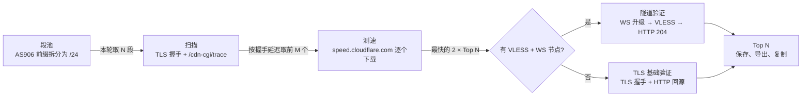

<div align="center">


# CF Best

**Cloudflare 优选 IP 桌面工作台**

扫描 · 测速 · 可用性验证 · 每日自动优选 —— 一个原生、轻量、无需订阅也能用的 GUI 工具

[](https://github.com/wintopic/CF-BEST/actions/workflows/ci.yml)
[](https://github.com/wintopic/CF-BEST/releases/latest)
[](https://github.com/wintopic/CF-BEST/releases)
[](LICENSE)


简体中文 · [English](README.en.md)


</div>

---

## 目录

- [为什么是 CF Best](#为什么是-cf-best)
- [功能](#功能)
- [截图](#截图)
- [下载安装](#下载安装)
- [快速上手](#快速上手)
- [工作原理](#工作原理)
- [快捷键](#快捷键)
- [数据与隐私](#数据与隐私)
- [从源码构建](#从源码构建)
- [项目结构](#项目结构)
- [参与贡献](#参与贡献)
- [致谢](#致谢)
- [免责声明](#免责声明)
- [许可证](#许可证)

## 为什么是 CF Best

优选 Cloudflare IP 通常要在多个脚本之间来回切换：先扫描、再测速、再逐个验证，最后手动整理结果。CF Best 把这条流程做成了一个桌面应用：

- **一键出结果**：「自动优选」按段池轮转扫描 → 测速 → 验证，直接给出今天最快的 Top N。
- **无需订阅**：扫描、测速和自动优选都不需要节点信息；有 VLESS + WebSocket 节点时才做完整的隧道验证。
- **每天自动跑**：到点运行、错过补跑、托盘常驻、开机自启，放着不管也能每天更新。
- **原生且轻量**：Rust + [GPUI](https://www.gpui.rs/) 自绘界面，单个可执行文件，启动快、占用低，没有 Electron。

## 功能

| 页面 | 作用 |
| --- | --- |
| **自动优选**（启动页） | 一键或每天定时执行「扫描 → 测速 → 验证」，整理并保存 Top N；段池按轮次推进，每轮换一批 IP 段 |
| **扫描 IP** | 从 IP 段、单个 IP、ASN 前缀或推荐段中找出可连通的 Cloudflare 地址，显示机房与握手延迟 |
| **测速排行** | 逐个下载测速（初筛 + 多轮精测），按中位速度排序；附速度分布直方图与「延迟—速度」散点图 |
| **可用性验证** | 用 VLESS + WebSocket 订阅节点做完整隧道验证（订阅可以是 `vless://` 链接或 Clash 配置）；没有节点时做 TLS 基础验证；通过的 IP 可一键导入本机代理软件 |
| **段池优化**（高级） | 切换段池策略（均衡轮转 / 网络优选 / 顺序覆盖），调整起点，粗测本机网络下各段的表现 |
| **历史记录**（高级） | 查看历次运行；对比最近两次测速的 Top 10 排名与速度变化 |

更多细节：

- 🔗 **手动三步一键衔接**：「下一步：测速」「下一步：验证」会载入结果并直接开始下一步。
- 💾 **结果自动恢复**：最近一次的扫描、测速与验证结果在重启后自动恢复。
- 📋 **复制与导出**：点击行复制 `IP:端口`，Top N 一键「复制全部」；导出 TXT / CSV（Excel 可直接打开）。
- 📥 **导入代理软件**：隧道验证通过后，把优选 IP 套到订阅节点上，一键导入本机的 Clash Verge、Karing、Stash、FlClash 等客户端；也可复制本机订阅地址或节点链接。客户端更新订阅即可拿到最新一轮自动优选的结果。
- 🔄 **检查更新**：启动时与每天自动检查（可关闭），有新版本时状态栏右下角提示。一键更新会同时测速 GitHub 直连与 gh-proxy.com 等国内镜像，走最快的线路下载，并用 GitHub 给出的 SHA-256 校验；Windows 自动替换并重启，macOS 打开安装包。
- ⏰ **可靠的定时运行**：到点后当天还没跑过就开始，错过时间会补跑，有任务时排队等待，后台运行不打断当前操作。
- 🎨 **主题**：森林 / 薄荷 / 蜜蜂 / 羊皮纸 4 种风格 × 浅色 / 深色 / 跟随系统；界面缩放 90%–125%。
- ⌨️ **全键盘操作**：页面切换、开始 / 停止任务、焦点移动都有快捷键。
- 🪟 **Windows 集成**：托盘常驻与通知、任务栏进度、开机自启到托盘。

## 截图

| 扫描 IP | 测速排行 |
| :---: | :---: |
|  |  |
| **可用性验证** | **深色主题** |
|  |  |

## 下载安装

前往 [**Releases**](https://github.com/wintopic/CF-BEST/releases/latest) 下载最新版本：

| 平台 | 文件 | 说明 |
| --- | --- | --- |
| Windows 10 / 11（x64） | `CFBest-<版本>-windows-x64.exe` | 免安装，双击运行 |
| macOS 11+（Apple 芯片 / Intel） | `CFBest-<版本>-macos-universal.dmg` | 打开后把 **CF Best** 拖入「应用程序」 |

每个版本都附带 `SHA256SUMS.txt`，可用于校验下载文件。

<details>
<summary><b>macOS 首次打开提示「无法验证开发者」？</b></summary>

安装包没有使用 Apple 开发者证书签名（仅做了 ad-hoc 签名）。首次打开时在 Finder 中**右键点击 CF Best → 打开**，或在终端执行：

```bash
xattr -dr com.apple.quarantine "/Applications/CF Best.app"
```

</details>

<details>
<summary><b>Windows 提示「Windows 已保护你的电脑」？</b></summary>

程序没有代码签名证书，SmartScreen 会对新发布的文件给出提示。点击「更多信息」→「仍要运行」即可。可以先用 `SHA256SUMS.txt` 校验文件。

</details>

## 快速上手

**只想要几个快的 IP？** 打开应用，在「自动优选」点 **立即运行一次**。几分钟后 Top N 就会出现在下方，点 **复制全部** 即可使用。

**想每天自动更新？** 打开 **每天自动运行** 并设定时间。应用会同时开启托盘常驻（Windows），关闭窗口后在托盘继续运行；再打开 **开机自启**，重启电脑后也会自动恢复。

**想手动控制每一步？**

1. **扫描 IP**：粘贴 IP 段（如 `104.16.0.0/24`），或点输入框右下角的推荐段，然后点 **开始扫描**。
2. **测速排行**：在扫描结果上点 **下一步：测速**，会按握手延迟取前 20 个逐个测速。
3. **可用性验证**：在测速结果上点 **下一步：验证**。如需完整的隧道验证，先在「订阅设置」中填入订阅链接；验证通过后，在结果下方的「导入代理软件」中点本机的客户端即可导入。

> 高级模式（侧栏底部开关或 `Ctrl+Shift+A`）会显示全部参数、段池优化与历史记录。简单模式与高级模式共用同一份参数，默认即推荐值。

## 工作原理



- **扫描**：并发连接每个 `IP:端口`，以 Cloudflare 的 SNI 完成 TLS 握手，并请求 `/cdn-cgi/trace` 读取机房代码（colo）。能返回 colo 的地址记为命中。
- **测速**：逐个串行测速，避免多个连接互相分摊带宽。每个候选先短时初筛，最快的若干个再做多轮精测，按中位速度排序。遇到 Cloudflare 限流（HTTP 429）会提示并适时停止。
- **验证**：
  - **隧道验证**：加载 VLESS + WebSocket 节点后，经该 IP 建立 WebSocket 隧道，通过 VLESS 访问 `cp.cloudflare.com/generate_204`，三步都成功才算通过。
  - **TLS 基础验证**：没有节点时，只检查 TLS 连接与 HTTP 回源。通过不代表代理节点可用，结果和导出文件里都会标明验证类型。
- **段池**：自动优选从 RIPE 拉取 AS906 的 IPv4 前缀并拆成 /24 段，每轮取连续 N 段，下一轮从后面继续，跑完一圈后开始新一轮。也可以按本机粗测结果排序（网络优选）。

## 快捷键

macOS 上用 `⌘` 代替 `Ctrl`。

| 快捷键 | 动作 |
| --- | --- |
| `Ctrl+1` ~ `Ctrl+4` | 自动优选 / 扫描 IP / 测速排行 / 可用性验证 |
| `Ctrl+5` / `Ctrl+6` | 段池优化 / 历史记录（高级模式） |
| `Ctrl+Enter` | 开始当前页面的任务 |
| `Ctrl+.` | 停止正在运行的任务 |
| `Ctrl+Shift+A` | 切换高级模式 |
| `Ctrl+B` | 收起 / 展开侧栏 |
| `Ctrl+=` / `Ctrl+-` / `Ctrl+0` | 放大 / 缩小 / 重置界面缩放 |
| `Tab` / `Shift+Tab` | 在按钮、导航与输入框之间移动焦点 |

## 数据与隐私

- 所有设置、历史记录与导出文件都保存在本机：
  - Windows：`%APPDATA%\CFBest`
  - macOS：`~/Library/Application Support/CFBest`
  
  侧栏底部的「数据目录」可以直接打开该文件夹。
- 应用只访问以下地址：被测 IP 本身、Cloudflare 的公开接口（IP 段列表、`/cdn-cgi/trace`、`speed.cloudflare.com`、`cp.cloudflare.com`）、RIPE Stat（查询 ASN 前缀）、你填写的订阅链接，以及检查与下载更新用的 GitHub 和下载镜像（gh-proxy.com、ghfast.top、ghproxy.net）。
- 导入过代理软件后，应用会在 `127.0.0.1` 上提供订阅地址供客户端更新（只接受本机访问，地址含随机令牌）；应用没在运行时，客户端保留上次导入的节点。
- 没有统计或遥测。检查更新只向 GitHub 查询最新版本信息，不上传任何数据，可在状态栏右下角的版本号弹层里关闭。订阅链接与节点信息只保存在本机：链接在 `settings.json`，最近一次成功载入的节点在 `subscription.json`（订阅拉取失败时沿用）。

## 从源码构建

需要 [Rust](https://rustup.rs/) 1.96+（edition 2024）。

```bash
git clone https://github.com/wintopic/CF-BEST.git
cd CF-BEST
cargo run --release
```

- **Windows**：需要 Visual Studio 的 MSVC 生成工具（“使用 C++ 的桌面开发”）。产物为 `target/release/CFBest.exe`，已内嵌图标与版本信息。
- **macOS**：需要 Xcode 命令行工具（`xcode-select --install`）。`.app` 与 `.dmg` 的打包步骤见 [`release.yml`](.github/workflows/release.yml)。

提交前检查（与 CI 一致）：

```bash
cargo fmt --check
cargo clippy --locked --all-targets -- -D warnings
cargo test --locked
cargo test --locked -- --ignored   # 需要联网的测试：边缘 trace、测速下载、RIPE 前缀等
```

<details>
<summary><b>调试用环境变量（仅 debug 构建）</b></summary>

使用任一变量时，本次运行不会写入设置。

| 变量 | 作用 |
| --- | --- |
| `CFBEST_THEME=bee-light` | 启动主题 |
| `CFBEST_PAGE=speed` | 启动页面（scan / speed / verify / daily / pool / history） |
| `CFBEST_SCALE=1.25` | 界面缩放 |
| `CFBEST_SIDEBAR=collapsed` | 收起侧栏 |
| `CFBEST_TRAY=1` | 开启托盘常驻 |
| `CFBEST_DEMO=1` | 载入内存中的演示数据 |
| `CFBEST_TRAY_SELFTEST=1` | 托盘自检，结果写入运行日志 |
| `CFBEST_UPDATE_POPOVER=1` | 启动时打开检查更新弹层 |
| `CFBEST_FAKE_VERSION=0.0.9` | 冒充旧版本，用来测试更新流程 |
| `CFBEST_AUTO_UPDATE=1` | 发现新版本后自动下载并安装（配合上一项，在程序副本上测试替换与重启） |

</details>

## 无窗口模式（cfbest-cli）

除图形界面外，仓库还带一个无窗口的命令行入口，适合放在常开机器上用计划任务 / launchd / systemd 定时跑：

```bash
cargo run --release --bin cfbest-cli -- --segments 20 --test 20 --top 5
```

它与图形界面共用同一份数据目录（设置、段池、订阅缓存、每日进度），两个入口可以交替使用：界面里配好订阅链接，命令行就能直接跑隧道验证。

| 选项 | 说明 |
| --- | --- |
| `--segments <N>` | 本轮扫描的 /24 段数（默认取设置） |
| `--test <N>` | 进入测速的 IP 数（默认取设置） |
| `--top <N>` | 最终保留的 Top N（默认取设置） |
| `--concurrency <N>` | 扫描并发（默认取设置） |
| `--out <PATH>` | 结果另存到文件 |
| `--json` | 以 JSON 输出到标准输出 |
| `--quiet` | 不打印过程日志 |
| `--reset` | 忽略上次进度，从段池第一段重新开始 |

Top 结果写标准输出、过程日志写标准错误，便于重定向与管道：

```bash
cfbest-cli --quiet > top.txt 2>> run.log
cfbest-cli --json --quiet | jq '.top[0]'
```

退出码：`0` 有结果，`3` 本轮无可用 IP，`1` 运行出错，`2` 参数错误。

## 项目结构

```
src/
  main.rs            窗口创建、快捷键与菜单
  bin/cfbest-cli.rs  无窗口的命令行入口，复用 core 的全部逻辑
  core/              与界面无关的业务逻辑：扫描、测速、验证、段池、每日优选、存储、统计
  app/               应用状态与各页面：侧栏、标题栏、事件处理、操作回调、*_page.rs
  ui/                通用组件：按钮、输入框、提示气泡、图表
  jobs.rs            后台任务调度（tokio）与事件
  theme.rs           主题、界面缩放与设计令牌
  theme_tokens.rs    由 tools/sync_qoder_tokens.py 生成的配色（不要手改）
  tray.rs            系统托盘（Windows）
  taskbar.rs         任务栏进度（Windows）
  autostart.rs       开机自启（Windows 注册表 / macOS LaunchAgent）
assets/              界面图标（SVG）与应用图标
docs/screenshots/    README 截图
.github/workflows/   CI 与发布流程
```

## 参与贡献

欢迎提交 Issue 和 Pull Request！开始之前请阅读 [CONTRIBUTING.md](CONTRIBUTING.md)。

- 🐛 [报告问题](https://github.com/wintopic/CF-BEST/issues/new?template=bug_report.yml)
- 💡 [功能建议](https://github.com/wintopic/CF-BEST/issues/new?template=feature_request.yml)

## 致谢

- [GPUI](https://www.gpui.rs/)：Zed 团队的 GPU 加速 UI 框架
- [tokio](https://tokio.rs/)、[rustls](https://github.com/rustls/rustls)：异步运行时与 TLS
- 应用图标的云朵图形来自 [Font Awesome Free](https://fontawesome.com)（[CC BY 4.0](https://fontawesome.com/license/free)）
- 界面布局与配色参考了 Qoder Design Kit

## 免责声明

本项目仅用于网络连通性与性能测试的学习和研究。请遵守所在地法律法规以及 Cloudflare 的服务条款，不要用于任何违法用途。测速会产生下载流量，请合理设置频率。

本项目与 Cloudflare, Inc. 无任何关联，也未获其认可。Cloudflare 及其标志是 Cloudflare, Inc. 的商标。

## 许可证

[MIT](LICENSE) © 2026 AIGCFREE
